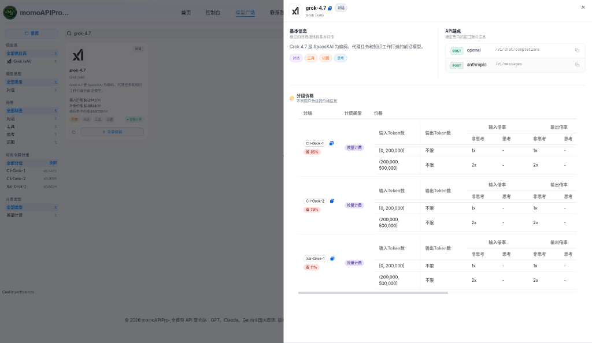

# Grok 4.7 API 调用教程：用 TryAllAPI 做 OpenAI 兼容对话接入

> **Grok 4.7**（模型 ID：`grok-4.7`）是 xAI 的对话模型，价格接口标签为「对话 / 工具 / 识图 / 思考」。本文记录如何通过聚合站 **[TryAllAPI](https://tryallapi.com/)**，从模型广场 / 价格页选型、读官方价与分组倍率，到 `POST /v1/chat/completions` 的完整接入流程。价格与分组倍率取数 **2026-10-21（北京）**，**以页面实时为准**；示例仅为请求形态说明，未跑通真实长任务计费。

**Keywords:** Grok 4.7 · grok-4.7 · xAI · TryAllAPI · OpenAI 兼容 · `/v1/chat/completions`

---

## 目录

- [为什么用聚合站调 Grok](#一为什么用聚合站调-grok)
- [在价格页 / 模型广场找到 Grok 4.7](#二在价格页--模型广场找到-grok-47)
- [模型怎么选：4.7 与相邻 Grok 档](#三模型怎么选47-与相邻-grok-档)
- [价格怎么读](#四价格怎么读)
- [调用流程：Key → Base URL → chat/completions](#五调用流程key--base-url--chatcompletions)
- [curl / SDK 最小示例](#六curl--sdk-最小示例)
- [常见注意](#七常见注意)
- [FAQ](#faq)
- [小结与试用入口](#八小结与试用入口)

---

## 一、为什么用聚合站调 Grok

xAI 原生 Base URL 是 `https://api.x.ai/v1`。对国内开发者来说，常见阻力是网络稳定性和境外支付；如果项目里还要同时调 GPT、Claude、Gemini，为每家维护一套 Key 和重试逻辑也比较散。

聚合站（如 [TryAllAPI](https://tryallapi.com/)）的常见价值：

1. **统一鉴权**：一个 Bearer Key，切换 `model` 字段即可试不同模型；
2. **OpenAI 兼容形态**：Base URL 固定为 `https://tryallapi.com/v1`，Cursor / Dify / 各类 SDK 改地址即可；
3. **模型广场可对照**：标签、分组倍率、端点类型一目了然。

代价是多一跳：延迟与可用性取决于分组上游，建议先用小流量探针。注册试用入口：[https://tryallapi.com/register?aff=5A6A](https://tryallapi.com/register?aff=5A6A)。

---

## 二、在价格页 / 模型广场找到 Grok 4.7

打开 [价格页](https://tryallapi.com/pricing) 或模型广场，按供应商 **Grok (xAI)**、类型 **对话**、关键词 `grok-4.7` 筛选。详情卡截图如下：



详情卡要点（取自价格接口 2026-10-21 快照）：

| 字段 | 内容 |
| --- | --- |
| **模型 ID** | `grok-4.7` |
| **供应商** | Grok (xAI) |
| **标签** | 对话、工具、识图、思考 |
| **端点类型** | `openai`（`POST /v1/chat/completions`）、`anthropic`（广场卡片显示 `POST /v1/messages`） |
| **可用分组** | Cli-Grok-1、Cli-Grok-2、Xai-Grok-1 |
| **计费** | 按量（token） |

更完整的参数卡可对照文档站：[Grok 4.7 API 指南](https://docs.tryallapi.com/grok-4.7-api/)。文档站信息卡写明：上下文 **500K tokens**，知识截止 2026-05（xAI 文档 NOTE），文档提及 reasoning，Responses 上可能返回加密 reasoning 内容。

---

## 三、模型怎么选：4.7 与相邻 Grok 档

只根据价格接口 / 文档站可见信息做对照，**不编造未出现的能力差异**。基价按价格接口 `model_ratio` / `completion_ratio` 换算（$/1M，未乘分组倍率）：

| 模型 ID（可见） | 标签 | 基价 输入 / 输出 | 怎么理解 |
| --- | --- | --- | --- |
| **`grok-4.7`** | 对话,工具,识图,思考 | $2 / $6 | 本文主线；文档称 Code/Chat 优先选 4.7 |
| **`grok-4.6`** | 对话,工具,识图,思考 | $2 / $6 | 同价位相邻版本，A/B 时只改 `model` |
| **`grok-4.5`** | 对话,工具,识图 | $2 / $6 | 标签无「思考」 |
| **`grok-4.3`** | 对话,工具,思考 | $1.25 / $2.5 | 价位更低的同厂商可见 ID |

文档站原话：公开价目表上 4.7 与 4.6 短上下文价一致，选型时更应看代码质量与工具调用。实务上：默认锁一个 `model` 写进配置；遇限流或分组无货，再在同厂商可见 ID 之间切换，而不是改 Base URL。

---

## 四、价格怎么读

对话模型常见公式：**≈ 官方价 × 分组倍率**（以控制台为准）。取数快照：**2026-10-21 北京**；**以页面实时为准**。

### 官方价（每百万 tokens，文档站 / xAI）

| 项目 | 提示 <200K | 提示 ≥200K（整次请求） |
| --- | --- | --- |
| 输入 | **$2.00** | **$4.00** |
| 缓存输入 | **$0.50** | **$1.00** |
| 输出 | **$6.00** | **$12.00** |

来源：[docs.tryallapi.com/grok-4.7-api](https://docs.tryallapi.com/grok-4.7-api/)（引自 xAI Models 文档）。价格接口中 `grok-4.7` 为 `model_ratio=1`、`completion_ratio=3`、`cache_ratio=0.25`，换算基价 $2 / $6 / 缓存 $0.50，与短档官方价一致；广场详情卡的分组价格表同样按输入 Token 数分段：`[0, 200000]` 输入 / 输出倍率 1x，`(200000, 500000]` 为 2x，与官方 ≥200K 加倍规则对应；实际扣费以控制台为准。

### 分组价格估算（<200K 档，官方 × group_ratio，$/1M）

| 分组 | group_ratio | 输入估 | 缓存输入估 | 输出估 |
| --- | --- | --- | --- | --- |
| **Cli-Grok-1** | 0.14706 | ≈ $0.294 | ≈ $0.074 | ≈ $0.882 |
| **Cli-Grok-2** | 0.2059 | ≈ $0.412 | ≈ $0.103 | ≈ $1.235 |
| **Xai-Grok-1** | 0.88236 | ≈ $1.765 | ≈ $0.441 | ≈ $5.294 |

长提示先按官方加倍规则估算，再乘倍率。**最终扣费以控制台流水为准**。

---

## 五、调用流程：Key → Base URL → chat/completions

```text
控制台创建 API Key（选 Cli-Grok / Xai-Grok 分组）
  → Base URL = https://tryallapi.com/v1
  → POST /v1/chat/completions   （model=grok-4.7）
  → 读 choices[0].message.content（或流式 delta）
```

建议：

- **超时**：文档示例用 `timeout=180`，长输出建议开流式；
- **密钥**：只放环境变量（如 `TRYALLAPI_KEY`），勿提交仓库；
- **Responses**：文档提到「若网关已映射」可用 `client.responses.create`，返回 404 就退回 Chat Completions；
- **Anthropic 兼容**：价格接口标注 `grok-4.7` 支持 `anthropic` 端点类型，文档站提到 Claude Code 可按站点说明配置 `ANTHROPIC_BASE_URL`、模型名仍写 `grok-4.7`（需网关支持协议转换）。专页没有给出 Grok 的完整 Anthropic 示例，本文不展开。

---

## 六、curl / SDK 最小示例

占位 Key `sk-xxx`（**不要**填入真实 Key）。

### 1）OpenAI 兼容 chat/completions

```bash
curl -sS https://tryallapi.com/v1/chat/completions \
  -H 'Authorization: Bearer sk-xxx' \
  -H 'Content-Type: application/json' \
  -d '{
    "model": "grok-4.7",
    "messages": [
      {"role": "user", "content": "修复并解释：function median(a){a.sort();return a[a.length/2]}"}
    ]
  }'
```

### 2）Python（OpenAI SDK，流式）

```python
from openai import OpenAI

client = OpenAI(
    api_key="sk-xxx",  # 建议改为读取环境变量
    base_url="https://tryallapi.com/v1",
    timeout=180,
)

stream = client.chat.completions.create(
    model="grok-4.7",
    messages=[{"role": "user", "content": "把这段 TypeScript 的 any 收紧成真实类型"}],
    stream=True,
)
for chunk in stream:
    if chunk.choices and chunk.choices[0].delta.content:
        print(chunk.choices[0].delta.content, end="", flush=True)
```

Cursor：Settings → Models → OpenAI API Key + Override Base URL `https://tryallapi.com/v1` → 自定义模型 `grok-4.7`。Dify：OpenAI-API-compatible，endpoint 填 `https://tryallapi.com/v1`。更多见 [文档站专页](https://docs.tryallapi.com/grok-4.7-api/)。

---

## 七、常见注意

1. **200K 跳档**：提示达到 200K 时整次请求按高档计价（$4 / $1 / $12），不是线性变贵；接近 200K 时就该告警。
2. **加密 reasoning**：Responses 上可能返回加密 reasoning 字段，客户端要容忍未知字段，也不要当用户可见文本展示。
3. **分组**：403 多为分组无货，换 Cli-Grok / Xai-Grok；低倍率分组先抽检质量。
4. **报错速查**：401 查 Bearer / 令牌；404 确认模型名 `grok-4.7` 且 base_url 含 `/v1`；429 退避或换分组；超时调高 timeout 并开流式。
5. **合规**：第三方聚合不是 xAI 官方服务，敏感代码先看条款。

---

## FAQ

### Grok 4.7 的模型 ID 是什么？

**`grok-4.7`**，请求体 `"model"` 填该字符串。

### TryAllAPI 的对话 endpoint 是什么？

- Base URL：`https://tryallapi.com/v1`
- 对话：`POST /v1/chat/completions`
- 价格接口同时标注 `anthropic` 端点类型，具体配置以站点说明为准。

### 官方价是多少？

提示 <200K：输入 $2 / 缓存输入 $0.50 / 输出 $6；≥200K：整单 $4 / $1 / $12（每百万 tokens，以 docs.x.ai 为准）。聚合侧再乘分组倍率（2026-10-21 快照：0.14706 / 0.2059 / 0.88236）。

### 上下文多长？

文档站写 500K tokens；价格在 200K 提示处加倍。

### 如何试用 TryAllAPI？

站点首页：[https://tryallapi.com/](https://tryallapi.com/)；注册试用入口：[https://tryallapi.com/register?aff=5A6A](https://tryallapi.com/register?aff=5A6A)。

---

## 八、小结与试用入口

把 Grok 4.7 接到业务里，核心是：**在价格页确认 model id 与 OpenAI 兼容 Base URL → 读懂官方价（注意 200K 跳档）× 分组倍率 → 用 chat/completions 先跑通非流式 ping，再开流式，最后接工具调用**。

| 资源 | 链接 |
| --- | --- |
| TryAllAPI 首页 | [https://tryallapi.com/](https://tryallapi.com/) |
| 注册试用（aff） | [https://tryallapi.com/register?aff=5A6A](https://tryallapi.com/register?aff=5A6A) |
| 文档站专页 | [grok-4.7-api](https://docs.tryallapi.com/grok-4.7-api/) |
| 价格页 | [tryallapi.com/pricing](https://tryallapi.com/pricing) |

价格取数 2026-10-21 北京，以页面实时为准。

---

## License

本文档以个人接入笔记形式发布，示例代码可自由复用。截图与模型广场文案归原平台；价格以实时页面为准。TryAllAPI 为第三方聚合，非 xAI 官方产品。
